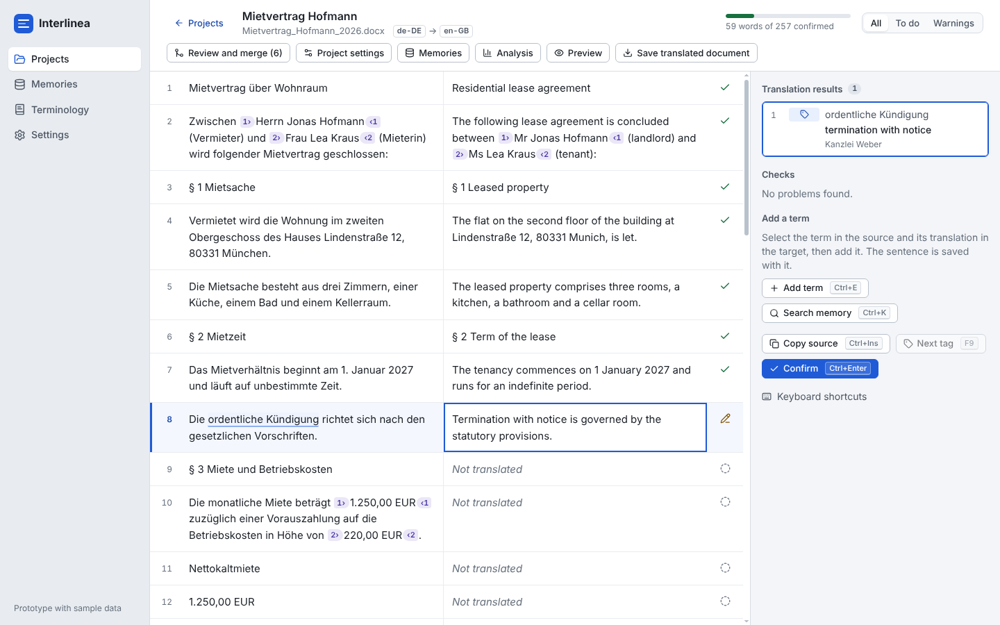
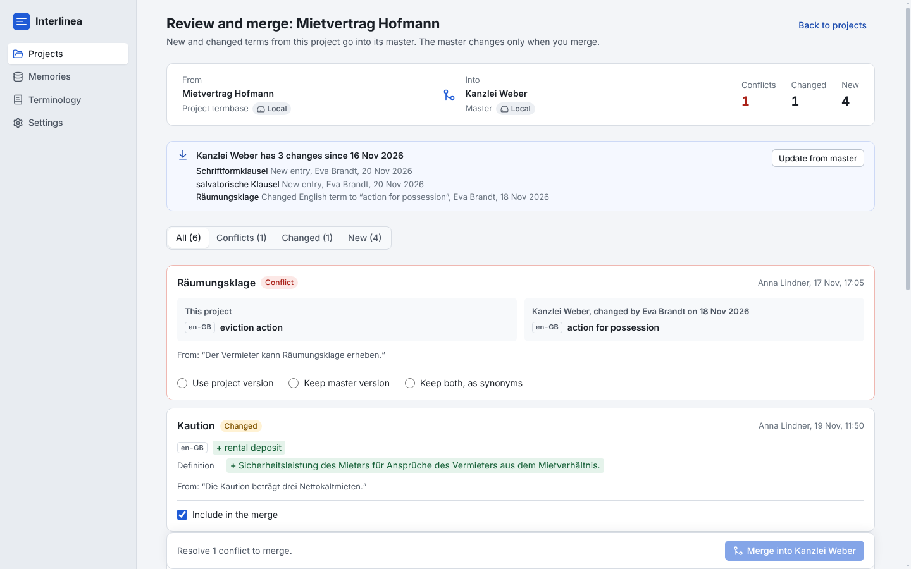
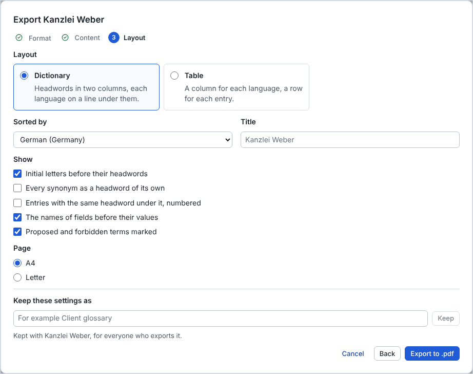
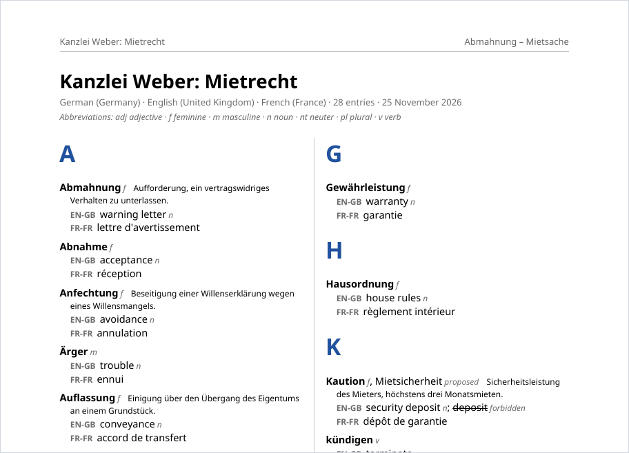
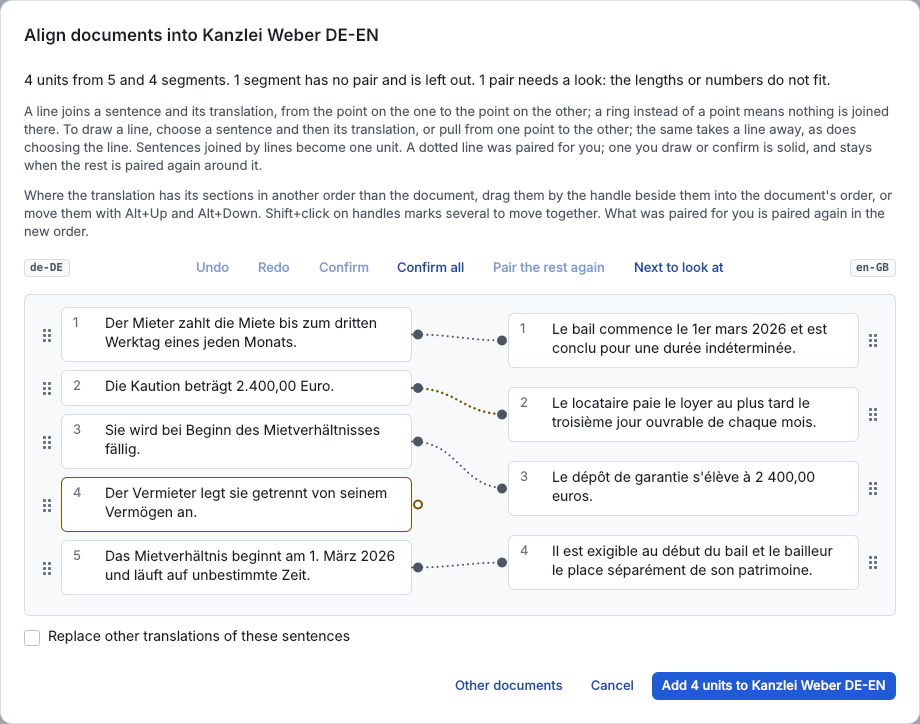

# Interlinea

**An open-source translation workspace.** A translation editor with
memories, terminology, quality checks and project workflow, as a desktop
app, in the browser, and on a team server that a team shares.

[](https://github.com/4nonX/interlinea/releases/latest)
[](LICENSE)
[](go.mod)
[](docs/desktop.md)
[](https://github.com/4nonX/interlinea/actions/workflows/ci.yml)



Interlinea opens the files translators are sent, including the bilingual
files and packages of Trados Studio, memoQ, Phrase and Wordfast, and
delivers them back as those tools expect. Everything works on your own
computer, without an account or a network. A team server adds shared
terminology, memories and projects when people work together.

## What it does

**Translate.** Source and target side by side, tags as numbered markers,
memory matches with their differences, terms from the termbases recognized
in the source (inflected forms included), checks as you type, spelling (with
dictionaries for 22 languages included) and grammar, suggestions from DeepL, Google, Microsoft or a language model with
the key of your own account, and a preview of the translated document. Repetitions are filled, confirmed segments go
into the memories, and the keyboard shortcuts are the familiar ones.

**Run projects.** Projects from documents, folders, bilingual files and
packages. The source language is detected and memories and termbases are
suggested for the client. Analysis with weighted word counts for quotes,
pre-translation, work given out to translators and reviewers with due
dates, scored review, and the translated files or return packages at the
end.

**Keep terminology.** Termbases with one concept per entry, any number of
languages, and fields of your own at entry, language and term level. A
project termbase collects what its project adds, and a review decides what
reaches the master, conflict by conflict.



**Print glossaries.** A termbase becomes a dictionary to print or send: a
PDF with headwords in two columns, initial letters, running heads and
grammar abbreviated as dictionaries do, a Word document, a web page with a
letter index and a search, or a table. Arabic and Hebrew included; no other
program needed.

<p>
  
  
</p>

**Build memories.** Memories from TMX, Trados Studio and Wordfast files,
searched with concordance, and made from documents translated before by
aligning them with their translations.



**Work as a team.** A team server keeps the termbases everyone translates
with, the review of new terms, projects and memories in one place. People
sign in with a password or the company's identity provider and get roles
on what they work on. Changes arrive live, and the apps show who is
working on which segment. Assistants and other programs connect through an
API and an MCP endpoint.

## Files

| Kind | Formats |
|---|---|
| Documents | Word, PowerPoint, Excel, OpenDocument, HTML, InDesign (IDML), XML, Markdown, PDF (the text), plain text |
| Software and subtitles | Java properties, JSON, YAML, PO, RESX, SRT, WebVTT |
| Bilingual files | XLIFF 1.2 and 2.x, SDLXLIFF, MQXLIFF, Phrase MXLIFF, Wordfast TXML, TagEditor TTX, and the review tables of Trados (DOCX), memoQ (RTF, DOCX) and Déjà Vu (RTF) |
| Packages | Trados project packages (.sdlppx in, .sdlrpx back), memoQ handoff packages (.mqout in, .mqback back) |
| Memories | TMX, Trados Studio (.sdltm), Wordfast (.txt) |
| Termbases | TBX 3 and 2, MultiTerm XML and .sdltb, CSV, TSV, Excel |

A translated file keeps everything that was not translated byte for byte.
[docs/formats.md](docs/formats.md) describes how each format is read and
written.

## Install

Every [release](https://github.com/4nonX/interlinea/releases) has the
installers, with their checksums in `SHA256SUMS`;
[CHANGELOG.md](CHANGELOG.md) says what each release brought.

**Desktop app**

| System | Download | |
|---|---|---|
| Windows | `Interlinea-<version>-windows-x64-setup.exe` | installs for you, without administrator rights; the portable zip needs no installing |
| macOS | `Interlinea-<version>-macos-universal.dmg` | drag the app to Applications; it is not signed with a developer certificate, so open it the first time with a right click and Open |
| Linux | `Interlinea-<version>-linux-x86_64.AppImage` | make it executable and start it |

**Team server, with Docker**

```
docker run -d --name interlinea -p 8080:8080 -v interlinea:/data \
  -e INTERLINEA_ADMIN_USER=admin -e INTERLINEA_ADMIN_PASSWORD='a long password' \
  ghcr.io/4nonx/interlinea-server:latest
```

Then open http://localhost:8080. [compose.yaml](compose.yaml) runs it with
PostgreSQL.

**Team server, without Docker.** Unpack
`interlinea-server-<version>-<system>-<processor>` and start
`interlinea-server -web web`. The command line tool `interlinea` is in the
same folder.

**Browser client alone.** `interlinea-web-<version>.zip` is the client as
static files for any web server. It keeps your work in the browser.

To try it with sample data, open the browser client with `?sample` at the
end of its address.

## Documentation

| | |
|---|---|
| [Using Interlinea](docs/guide.md) | projects, the editor, memories, terminology, glossaries, working on a team server |
| [File formats](docs/formats.md) | what is read and written, format by format |
| [Matches, terms and checks](docs/matching.md) | match scores, term recognition, spelling, quality checks, performance |
| [Command line](docs/cli.md) | `interlinea`: memories, termbases, documents, packages, analysis, checks |
| [Running a team server](docs/running.md) | HTTPS, reverse proxies, identity providers, backups, upgrades |
| [Team server](docs/server.md) | sign-in, roles and permissions, the API at a glance |
| [API reference](docs/api.md) | every route, also as OpenAPI at `/api/openapi.json` |
| [Translation services and assistants](docs/integration.md) | machine translation, grammar services, MCP, access tokens |
| [Languages](docs/languages.md) | the languages offered and what is checked for each |
| [Desktop app](docs/desktop.md) | how the desktop app is built, its look and tests |
| [Development](docs/development.md) | building, testing, fuzzing, the packages |

## Building from source

Go 1.24 or newer; no C compiler is needed.

```
go build -o bin/ ./cmd/...        # the server, the command line, the desktop app's core
go test ./...

make wasm dictionaries && cd web && npm install && npm run dev   # the browser client
cmake -S desktop -B build/desktop && cmake --build build/desktop   # the desktop app (Qt 6.4+)
```

[docs/development.md](docs/development.md) has the rest: tests, fuzzing,
the layout of the code and the screenshots.

## License

Copyright (C) 2026 Dan Dreßen.

Interlinea is free software: you can redistribute it and modify it under
the terms of the GNU Affero General Public License, version 3
(AGPL-3.0-only), as published by the Free Software Foundation. The full
text is in [LICENSE](LICENSE), the copyright notice in [NOTICE](NOTICE).
Every download carries both, and both apps show them under Settings,
About Interlinea.

It comes without any warranty, to the extent the law allows. If you run a
changed version of the team server for others to use over a network, the
licence asks you to offer them the source of your version.
