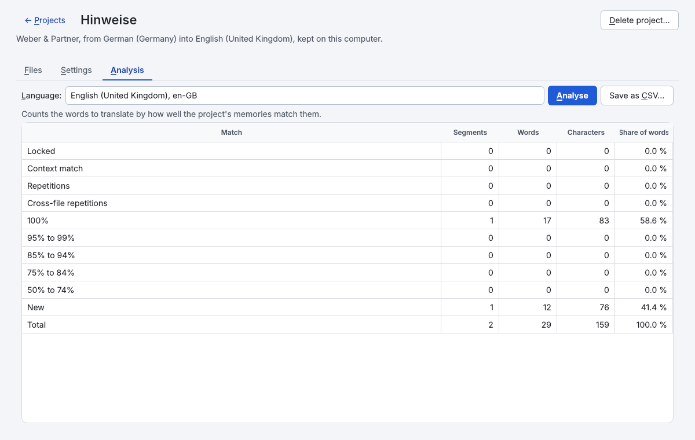

# Interlinea

An open-source translation workspace: CAT editor, terminology, translation
memory and project workflow in one tool, translation first.

This repository holds the Go core, the team server, the native desktop app
(Qt 6) and a browser client.


The editor in the browser client: source and target side by side, tags as
numbered markers, terms from the termbase underlined in the source with
their translation in the results, checks for the segment, and the
shortcuts from Trados Studio and memoQ. The desktop app gets the same
editor in its next stage.


## Install

Every release has what is installed, on the
[releases page](https://github.com/4nonX/interlinea/releases), with its
checksums in `SHA256SUMS`. [CHANGELOG.md](CHANGELOG.md) says what each
release brought.

- **Desktop app.** Windows: `Interlinea-<version>-windows-x64-setup.exe`
  installs it for you, without administrator rights; the portable folder
  next to it needs no installing. macOS: open
  `Interlinea-<version>-macos-universal.dmg` and drag the app to
  Applications; it is not signed with a developer certificate, so open
  it the first time with a right click and Open. Linux: make
  `Interlinea-<version>-linux-x86_64.AppImage` executable and start it.
- **Team server, with Docker.**

  ```
  docker run -d --name interlinea -p 8080:8080 -v interlinea:/data \
    -e INTERLINEA_ADMIN_USER=admin -e INTERLINEA_ADMIN_PASSWORD='a long password' \
    ghcr.io/4nonx/interlinea-server:latest
  ```

  Then open http://localhost:8080. For PostgreSQL, take
  [compose.yaml](compose.yaml). While the repository is private, so is
  the image: sign in first with `docker login ghcr.io`.
- **Team server, without Docker.** Unpack
  `interlinea-server-<version>-<system>-<processor>` and start
  `interlinea-server -web web`. The command line tool `interlinea` is in
  the same folder.
- **Web client alone.** `interlinea-web-<version>.zip` is the client as
  static files for any web server; it keeps its data in the browser.

[docs/running.md](docs/running.md) describes setting up a server: HTTPS,
sign-in through a provider, backups.

## Status

- **Core:** file filters for Word, PowerPoint, Excel, OpenDocument (ODT,
  ODS, ODP), web pages (HTML), InDesign (IDML), XML, Markdown, software
  strings (properties, JSON, YAML, PO, RESX), subtitles (SRT, WebVTT),
  XLIFF 1.2 and 2.x, SDLXLIFF, MQXLIFF (also as .mqxlz), Trados packages,
  memoQ handoff packages, plain text, and the text of PDF files; alignment
  of documents done
  before; translation memories; termbases with
  TBX, MultiTerm, CSV and Excel exchange; QA, spelling, analysis and
  pre-translation. Done and tested.
- **Team server:** first of all a team's terminology in one place:
  termbases with review of what projects add and change. Also projects
  and memories, accounts and roles, password and OpenID Connect
  sign-in, a live feed of changes, backups. API reference in [docs/api.md](docs/api.md), running
  guide in [docs/running.md](docs/running.md). The languages both apps
  offer, and what is checked for each, are in
  [docs/languages.md](docs/languages.md).
- **Desktop app:** works without a server and connects to team servers.
  It has the pages of the browser client in the same layout: projects
  and new projects from documents, the editor, memories, terminology
  with review, accounts and settings ([docs/desktop.md](docs/desktop.md)).
- **Browser client:** in `web/`, with the editor and
  terminology management, running against the team server or on its own
  with the core compiled to WebAssembly.

The Go packages:

| Package | What it does |
|---|---|
| `content` | Segment model: text interleaved with inline tags (open, close, standalone), JSON encoding, slicing at segment boundaries |
| `langtag` | BCP 47 normalization and matching (`de_de` to `de-DE`, primary-language matches) |
| `segment` | SRX 2.0 parser and segmenter, built-in rules for German, English, CJK and a generic fallback |
| `fuzzy` | Match percentages: a weighted edit distance over words, numbers, punctuation and tags, aware of case, marks, word forms, the digits and punctuation of every script, and scripts written without spaces |
| `tmx` | Streaming TMX 1.4b reader and writer (UTF-8, UTF-16, ISO-8859-1, Windows-1252), inline markup mapped to tags |
| `tm` | Translation memory model, the `Memory` interface, an in-memory backend, TMX import and export, penalties for less trusted memories |
| `tm/tmdb` | Persistent backend: any number of memories in a SQLite file (desktop) or PostgreSQL (server); term index for fuzzy candidates, trigram index for concordance, unit versions that refuse stale edits, change log for syncing |
| `tm/tmtest` | Conformance suite every `tm.Memory` backend must pass |
| `align` | Alignment of a document with its translation into pairs for a memory: sentence lengths after Gale and Church, numbers as anchors in any notation, paragraphs kept where both documents have the same ones; pairs of one to one, two to one, one to two, two to two, and segments left out |
| `term/termdb` | Persistent termbases: any number in one SQLite file, every version of every entry, edits on stale copies refused, term index for lookups, FTS5 trigram search, imports in one transaction |
| `internal/sqlitedb` | Opens the SQLite stores with shared settings (WAL, busy timeout) and migrates their schema |
| `filter` | What file filters hand over: units with inline tags and the document structure they sit in |
| `filter/docx` | Word filter: extracts body, footnotes, endnotes, comments, headers and footers, text boxes, content controls, chart text and SmartArt; rebuilds the file from translations, keeping every byte it did not translate |
| `filter/pptx` | PowerPoint filter: slides in the order of the show with their tables, charts and SmartArt, then each slide's speaker notes (shares the reading of DrawingML with the Word filter) |
| `filter/xlsx` | Excel filter: cells sheet by sheet, a shared text once; comments, text boxes and chart titles; numbers, dates and formulas left alone |
| `filter/html` | Web page filter: runs of text between block elements with inline elements as tags; the title, description and the attributes people read; scripts, styles and translate="no" left alone; any encoding |
| `filter/textfmt` | Software strings and subtitles: Java properties, JSON, YAML, gettext PO, .NET RESX, SubRip and WebVTT. One string is one unit; placeholders (%s, {0}, {{name}}, ${name}) and markup are tags; keys, comments, times and everything outside the strings stay byte for byte; escapes and encoding written as the file had them |
| `filter/xmlfmt` | Any XML (an element that holds text is a paragraph, the elements in it are tags, translate="no" is left alone) and OpenDocument text, spreadsheets and presentations (paragraphs and headings with footnotes and text boxes read as paragraphs of their own; cells of numbers and formulas left alone) |
| `filter/markdown` | Markdown: headings, paragraphs, list items, quotes and table cells, with emphasis, links, images, code in a line and HTML as tags; code blocks, front matter and link definitions left alone |
| `filter/idml` | InDesign IDML filter: stories in page order, paragraphs with character formats and links as tags, tables and footnotes after the paragraph that holds them |
| `filter/pdf` | Reads the text of PDF files, without any other program: the objects of the file (also packed in streams, also with a broken table of objects), fonts with their maps to text, encodings and glyph names, and the text shown on each page with where it stands. Lines, columns and paragraphs are found from the places, a word divided at the end of a line is whole again, and the text is handed on as a Word document, which is what the translation is saved as |
| `filter/para` | What the document filters share: a paragraph's content cut into sentence units, and translations put back with their tags matched and nested |
| `filter/formats` | The formats by file name, and one way to extract and merge any document |
| `filter/xliff` | Bilingual files: XLIFF 1.2, Trados SDLXLIFF, memoQ MQXLIFF, XLIFF 2.0 to 2.2; segments with targets, states, locks, match values and notes; writes translations and states back, changing only those bytes |
| `filter/sdlpackage` | Trados project packages (.sdlppx): languages and bilingual files; return packages (.sdlrpx) with the translated files |
| `filter/mqpackage` | memoQ handoff packages (.mqout) and memoQ XLIFF archives (.mqxlz): the documents as memoQ XLIFF; delivery packages (.mqback) |
| `term` | Termbase model (concept entries, languages, terms, statuses, fields at entry, language and term level); reads and writes TBX 3, TBX 2, MultiTerm XML, CSV, TSV and Excel, and reads MultiTerm termbase files (.sdltb); import planning (merge, overwrite, skip, add), duplicate detection, term recognition and terminology checks |
| `analysis` | Word counts and analysis against memories as in Trados and memoQ: locked, context matches (101%, segment before or before and after), repetitions within and across files, 100%, fuzzy bands, new; segments, words, characters, tags and placeables per file and in total; weighted word counts for quotes; reports in HTML, CSV and JSON |
| `qa` | Quality checks as in Trados, memoQ and Xbench: empty and untranslated segments, tags (missing, extra, nesting), numbers read with each language's separators, end punctuation, spacing (double, leading and trailing, before punctuation, French no-break spaces), brackets, repeated words, capitalization, length limits and ratio, consistency across segments, terminology, spelling, rules of your own (regular expressions); reports in HTML, CSV and JSON |
| `spell` | Hunspell spelling in Go: reads LibreOffice, Firefox and system dictionaries (.aff/.dic, .oxt extensions), affixes, compounds, all flag types and character sets, suggestions in Hunspell's order |
| `project` | Project setups: languages, translatable and reference files, memories per target language (lookup, concordance, update, penalty), terminology (project termbase over masters, directly into a master, own), context rule, QA switches, preparation; validation that names the field of every problem; templates; pre-translation from memories as the analysis counts matches |
| `project/projectdb` | Persistent projects in a SQLite file or PostgreSQL: settings, files with their bytes, segments per file and target language with versions that refuse stale saves, target languages added or removed later, pre-translation applied safely, templates, assignments of files, languages or segment ranges to translators and reviewers with due dates (one of each per segment), who has which segment open, change log for syncing |
| `auth/authdb` | Accounts with Argon2id passwords, OpenID Connect identities, sign-in tokens (only their hashes stored), roles as sets of permissions (read, suggest, edit, approve, manage: five built-in roles, each a permission and the ones before it, and roles administrators define) on projects, memories, termbases or everything; the last administrator is kept; change log; SQLite or PostgreSQL |
| `auth/oidc` | OpenID Connect sign-in (Entra ID, Google, Keycloak and others): discovery, authorization code with PKCE, ID token checks (RS256, PS256, ES256 against the provider's keys, issuer, audience, expiry, nonce) |
| `server` | The team server's HTTP API: sign-in with passwords or an identity provider, accounts and roles, projects with their files, segments, assignments and presence, memories, termbases with their review workflow, a live feed of changes |; an MCP endpoint for AI assistants ([docs/integration.md](docs/integration.md))
| `cmd/interlinea-server` | The team server: SQLite files or PostgreSQL, the web app at `/`, TLS or a reverse proxy |
| `cmd/interlinea-core` | The desktop app's core: the same API on the person's own computer, on the loopback interface, with one account and a token handed to the app at start ([docs/desktop.md](docs/desktop.md)) |
| `langdetect` | Guesses a document's language: scripts by their share of the letters, Latin-script languages by function words; says when the text is too short or mixed to tell |
| `cmd/interlinea-apidoc` | Writes the API reference (`server/openapi.json`, `docs/api.md`) from the server's source |
| `cmd/interlinea` | Command-line interface to all of the above |
| `cmd/interlinea-wasm` | The filters, memories, termbase formats, QA, analysis, project validation and pre-translation compiled to WebAssembly for the browser client |

The SQLite driver is pure Go (SQLite compiled to WebAssembly), so builds need
no C compiler on any platform.

## Build

Requires Go 1.24 or newer. No C compiler is needed.

```
go build -o bin/ ./cmd/...
go test ./...
```

Install the command line tool directly:

```
go install github.com/4nonX/interlinea/cmd/interlinea@latest
```

With `make`:

```
make all      # gofmt check, vet, tests, build
make race     # tests with the race detector
make bench    # benchmarks
make cross    # binaries for Linux, macOS and Windows (amd64, arm64)
make wasm     # the core for the browser client (web/public/core)
make sample   # regenerate the sample Word document and its extraction
```

## Desktop app

`desktop/` is the native app: Qt 6 Widgets, C++20. It works on its own,
with its core (`interlinea-core`) keeping the person's work in SQLite files
in the app's data folder, and connects to team servers. Sign-ins to team
servers are kept in the system's keychain. See [docs/desktop.md](docs/desktop.md)
for the plan, its stages and more screenshots.

| | |
|---|---|
|  |  |

```
cmake -S desktop -B build/desktop      # needs Qt 6.4 or later and Go
cmake --build build/desktop
ctest --test-dir build/desktop         # starts the core; QT_QPA_PLATFORM=offscreen is set
```

The build puts `interlinea-core` next to the app, where the app starts it.
`INTERLINEA_CORE` and `INTERLINEA_DATA` point the app at another core or
data folder.

## Team server

`interlinea-server` is first of all where a team shares its terminology:
master termbases everyone translates with, and the review that new and
changed entries pass before they reach them. It keeps projects, memories
and accounts for the team as well. It runs on SQLite files (`-data`, the default) or PostgreSQL
(`-postgres`, each store in its own schema), and serves the web app from
`-web`. Every option is also an environment variable (`-addr` is
`INTERLINEA_ADDR`); `interlinea-server -h` lists them.

```
docker build -t interlinea-server .
docker run -p 8080:8080 -v interlinea:/data \
  -e INTERLINEA_ADMIN_USER=admin -e INTERLINEA_ADMIN_PASSWORD='a long password' interlinea-server
```

`compose.yaml` runs it with PostgreSQL. Without `INTERLINEA_ADMIN_*`, a server
with no accounts logs a setup token, and `POST /api/setup` makes the first
administrator with it. [docs/running.md](docs/running.md) covers HTTPS and
reverse proxies, identity providers, backups (`interlinea-server backup`),
upgrades and sizing; [docs/api.md](docs/api.md) is the API reference, also
served as OpenAPI 3.1 at `/api/openapi.json`.

**Signing in.** `POST /api/auth/password` with a username and password
returns a token for the `Authorization: Bearer` header; the stores keep only
its hash. The web app the server serves asks for an HttpOnly cookie instead
(`X-Interlinea-Session: cookie`), so the browser keeps no token; requests
signed in with it carry the `X-Interlinea` header. After ten wrong passwords an account waits 15 minutes, and one
address gets twenty attempts a minute. With `-oidc-issuer` and
`-oidc-client-id` (Entra ID, Google, Keycloak, any OpenID Connect provider;
the redirect address is `<public URL>/api/auth/oidc/callback`), the apps
start a sign-in with `POST /api/auth/oidc/start`, open the address it gives,
and get a one-time code back in the fragment of their return address (the
server, an allowed web app, or an app listening on `127.0.0.1`), which
`POST /api/auth/exchange` turns into a token. Tokens never appear in an
address. People link their provider sign-in to their account themselves, an
administrator links it, or `-oidc-create-users` makes accounts (without
roles) on first sign-in.

**Who may do what.** Roles are read < suggest < edit < approve < manage, on
one project, memory or termbase, on all of a kind (`*`), or on everything.
Administrators may do everything; managers decide who may use what they
manage. Making projects takes manage on all projects; the maker manages the
project and what was made with it. Work assigned in a project lets people
see it, save their segments (reviewers correct the translators'), add terms
to its termbase and look up in its memories, with no grant on the memories
themselves. What someone may not see answers 404.

A role is a set of permissions. The five that come with the server each
include the ones before them. Administrators define others on the Accounts
page, in the browser and in the desktop app, for combinations the ladder
does not have: a reviewer who reads, suggests and approves but does not
edit, for one. A role of one's own is given like any other, and changing
what it allows changes it at once for everyone who has it; one that people
have is not deleted. Grants add up: what someone may do with a termbase is
everything their roles on it, on all termbases and on everything allow
together. `GET /api/roles`, `PUT /api/roles/{name}` and
`DELETE /api/roles/{name}` are the API for it.

**Writes** name the version they were made from (`If-Match` or `?version=`)
and are refused with 409 `conflict` when someone saved in between. Errors are
`{"code", "message", "problems": [{"field", "message"}]}`.

| Routes | |
|---|---|
| `/api/me`, `/api/people`, `/api/users`, `/api/grants` | the signed-in person, their sign-ins and identities; whom work can go to; accounts (administrators); roles |
| `/api/catalog`, `/api/templates` | memories and termbases to set projects up with; project templates |
| `/api/projects/{id}` and below | settings, files (bytes in, originals out), segments, pre-translation, lookup and concordance in the project's memories, its terminology, assignments, presence, change log |
| `/api/memories/{name}` and below | units, lookup, concordance, TMX import and export, change log |
| `/api/termbases/{name}` and below | entries, history, revert, merge, duplicates, lookup, the layered view of a project termbase, import and export (TBX, MultiTerm, CSV, TSV, Excel), review rules, merge requests |
| `/api/merge-requests/{id}` and below | items, samples, progress, decisions, reviewers, closing, reverting |
| `/api/events` | server-sent events for every change the person may see; reconnecting with `Last-Event-ID` sends what was missed |

Creating a project (`POST /api/projects`) makes its own memories and its
termbase (layered over the masters, or on its own) with it, and removes
them again if the project is refused. The apps send a translatable file with
its segments; the server reads documents and XLIFF files itself and refuses
segments that are not the file's (and checks that a text file's segments
are its text), keeping the file's own source text and locks. Memories and termbases a project or
template uses are not deleted under it, and renaming a termbase renames it
in their settings.

## Command line

Stored translation memories:

```
interlinea tm create -name Mietrecht -src de-DE -tgt en-GB
interlinea tm import -name Mietrecht memory.tmx
interlinea tm import -name Mietrecht -overwrite -primary other.tmx
interlinea tm list
interlinea tm lookup -name Mietrecht "Der Mieter haftet für Schäden."
interlinea tm concordance -name Mietrecht -target "leased property"
interlinea tm export -name Mietrecht -o mietrecht.tmx
interlinea tm delete -name Mietrecht -yes
```

Memories live in `Interlinea/memories.db` in the user configuration directory
(`%AppData%` on Windows, `~/Library/Application Support` on macOS,
`~/.config` on Linux). `-db` or the `INTERLINEA_DB` environment variable
selects another file.

Stored termbases:

```
interlinea termbase create -name "Kanzlei Weber" -langs de-DE,en-GB
interlinea termbase import -name "Kanzlei Weber" -dry-run client.tbx
interlinea termbase import -name "Kanzlei Weber" -match term -on merge client.tbx
interlinea termbase import -name "Glossar" -create -mapping mapping.json glossary.xlsx
interlinea termbase search -name "Kanzlei Weber" -lang de -status approved miet
interlinea termbase lookup -name "Kanzlei Weber" -lang de Kaution
interlinea termbase show -name "Kanzlei Weber" c12
interlinea termbase history -name "Kanzlei Weber" c12
interlinea termbase duplicates -name "Kanzlei Weber" -lang de
interlinea termbase merge -name "Kanzlei Weber" c12 c40
interlinea termbase recognize -name "Projekt,Kanzlei Weber" -src de-DE -tgt en-GB "Die Kaution ..."
interlinea termbase export -name "Kanzlei Weber" weber.tbx
```

Termbases live in `Interlinea/termbases.db` next to the memories
(`-db` or `INTERLINEA_TERMDB` for another file). Every change keeps the
previous version with who made it and why; deleted entries are kept as a
record. Entries keep the IDs of the file they came from when those are
free, otherwise they are numbered c1, c2 and so on, which are valid TBX IDs,
so a TBX export imported back with `-match id` finds them again.

Other commands:

```
interlinea segment -lang de-DE contract.txt
interlinea segment -lang en -srx my-rules.srx -json notes.txt
interlinea tmx-info memory.tmx
interlinea lookup -tmx memory.tmx -tgt en-GB "Der Mieter haftet für Schäden."
interlinea lookup -tmx memory.tmx -tgt en-GB -min 60 -n 10 -json "..."
interlinea concordance -tmx memory.tmx -tgt en-GB Mietsache
interlinea concordance -tmx memory.tmx -tgt en-GB -target "leased property"
interlinea score "Der Mieter haftet." "Der Vermieter haftet."
interlinea extract -lang de-DE lease.docx          # also .pptx, .xlsx, .html, .idml
interlinea extract -lang de-DE -json lease.docx > units.json
interlinea merge -lang de-DE -target en-GB -o lease_en-GB.docx lease.docx translations.json
interlinea package info Hofmann.mqout             # also .sdlppx
interlinea package extract -o work Hofmann.mqout
interlinea package return -o Hofmann.mqback Hofmann.mqout work
```

Bilingual XLIFF files (from Trados, memoQ, Phrase or any XLIFF tool):

```
interlinea xliff info Mietvertrag.docx.sdlxliff
interlinea xliff extract -state new Mietvertrag.docx.sdlxliff
interlinea xliff extract -json Mietvertrag.mqxliff > segments.json
interlinea xliff merge -o Mietvertrag.docx.sdlxliff Mietvertrag.docx.sdlxliff updates.json
```

Trados project packages:

```
interlinea package info "Mietvertrag Hofmann.sdlppx"
interlinea package extract -o work "Mietvertrag Hofmann.sdlppx"
# translate work/en-GB/*.sdlxliff, then:
interlinea package return -o "Mietvertrag Hofmann.sdlrpx" "Mietvertrag Hofmann.sdlppx" work
```

`updates.json` maps segment IDs to `{"target": ..., "state": ...}` (target as
a plain string or the run array `extract -json` prints) or to a plain string,
which also sets the state to translated.

Analysis and word count (the basis for quotes):

```
interlinea analyze -src de-DE Mietvertrag.docx                          # word count only
interlinea analyze -src de-DE -tgt en-GB -tmx client.tmx -tm Mietrecht \
    -weights context=0,repetition=10,cross-file=10,100=30,95=60,85=60,75=100 \
    -format html -o analysis.html Mietvertrag.docx Anlage.docx
interlinea analyze -context both work/*.sdlxliff                       # memoQ's context rule
```

Bands are `locked`, `context`, `repetition`, `cross-file`, `100`, `95`,
`85`, `75`, `50` and `new`. A band without a weight counts fully, except
locked segments (0). Context matches need memory units that record their
neighbouring segments, as memoQ's TMX does (`x-context-pre`,
`x-context-post`); Trados stores a hash of the context that other tools
cannot read, so Trados memories give 100% matches instead.

Quality checks and spelling (exit code 1 when errors are found, so a script
or CI job can stop):

```
interlinea qa -checks                                    # what is checked, on or off by default
interlinea qa -dict ~/dictionaries/de_DE_frami.oxt -termbase Mietrecht \
    -rules our-rules.json -format html -o qa.html Mietvertrag.docx.sdlxliff
interlinea qa -disable capitalization -enable length-ratio,inconsistent-source work/*.sdlxliff
interlinea spell -dict /usr/share/hunspell/de_DE "Kaution Mietvertrg"
```

`our-rules.json` is a list of rules: `{"name": "Euro sign", "source": "EUR",
"target": "€", "mode": "must"}`; `mode` is `must`, `must-not` or `count` (the
translation matches `target` as often as the source matches `source`), with
an optional `severity` (`error` or `warning`) and `message`. `-words` names a
file of words that are always right (one per line).

Termbase files:

```
interlinea term info glossary.xlsx
interlinea term convert glossary.xlsx glossary.tbx            # TBX 3
interlinea term convert -to tbx2 client.tbx client_v2.tbx
interlinea term convert export.xml export.csv                  # MultiTerm XML to CSV
interlinea term mapping glossary.csv > mapping.json            # edit, then:
interlinea term convert -mapping mapping.json glossary.csv glossary.tbx
interlinea term duplicates -lang de client.tbx
interlinea term recognize -src de-DE -tgt en-GB -target "The operating costs." client.tbx "Die Betriebskosten."
```

`translations.json` maps unit IDs to their translation, either a plain string
or the run array `extract -json` prints (with tags as `{"tag":{"kind":"open","id":"1"}}`).
Units without a translation keep their source text.

`segment` treats blank lines as paragraph boundaries and prints one segment
per line. `lookup` and `concordance` load the TMX file into memory; `-src`
overrides the header's source language and `-primary` also accepts variants
that match by primary language only (`de-AT` for `de-DE`).

## Notes on behaviour

- Word documents: formatting that changes inside a paragraph (bold, italic,
  underline, other run formatting, links) becomes paired tags; tabs, line
  breaks, fields, images, footnote references and bookmarks become
  placeholders that carry the original markup. Formatting of a whole
  paragraph is not tagged, and tags at the paragraph edges (a footnote mark
  at the end, a bookmark at the start) stay out of the units. A sentence
  break inside a tag pair is not used, so tags never cross units. On merge,
  only paragraphs with units are rewritten; styles, numbering, images,
  sections and all other parts are copied byte for byte. Rewritten text gets
  the target language (`w:val`, or `w:eastAsia` / `w:bidi` for the scripts
  Word keeps separately). A translation that leaves a span open has it closed
  at the end of the unit; a placeholder left out of a translation is not
  written. Text boxes (with their compatibility fallback), content controls,
  comments, chart titles and labels (and the chart's embedded workbook) and
  SmartArt text (and its drawing cache) are extracted too. Tags say what they
  are (bold, colour, font, size, style, link and so on). Tracked changes in
  a rewritten paragraph are accepted, with a warning; `-keep-revisions`
  keeps them as tags instead.
- XLIFF: segments keep their Trados, memoQ or XLIFF state, mapped to
  Interlinea's new, draft, translated, reviewed, final and rejected (Trados
  Not Translated, Draft, Translated, Approved Translation, Approved
  Sign-off, Rejected; memoQ Not started, Pre-translated or Edited,
  Confirmed, Reviewer 1 confirmed, Proofread, Rejected; XLIFF 1.2 and 2
  `state`). Merge writes only the target of each changed segment and its
  state: the Trados confirmation level in `sdl:seg-defs` (and origin
  `interactive` for edited text), the memoQ `mq:status`, or the XLIFF
  `state` (XLIFF 2 drafts and rejections as `subState`
  `interlinea:draft` and `interlinea:rejected`). Locked segments (Trados
  and memoQ locks) cannot change. Trados tracked changes in a segment stay
  as tags; their deleted text is not translatable. Files in UTF-8 or UTF-16
  are written back in the same encoding. Not read yet: `alt-trans`
  suggestions in XLIFF 1.2 and the XLIFF 2 matches module.
- Trados packages: a return package holds the package's project file with
  `PackageType="ReturnPackage"` (every other byte as it was, so Trados
  matches it to its project) and the package's SDLXLIFF files, the
  translated ones replaced; memories, termbases and settings are not sent
  back.
- memoQ handoff packages (.mqout): the documents are read as memoQ XLIFF,
  out of their archives (.mqxlz) where they are in one; the package's
  memories (TMX) and term bases (CSV) stay in it and can be imported from
  it by hand. The delivery package (.mqback) holds the documents as memoQ
  XLIFF and DeliveryPackageInfo.xml, made from the handoff's
  HandoffPackageInfo.xml the way delivery packages are put together by
  hand: the HandoffPackageInfo element named HandoffDeliveryPackageInfo,
  its UserName named User. memoQ publishes no description of these files,
  and the delivery package has not been tried against memoQ: if memoQ
  does not take it, save the documents one by one (Save XLIFF) and bring
  them in with memoQ's import of bilingual files, which is documented.
  A memoQ XLIFF archive on its own is a bilingual file and is saved back
  as the archive it was.
- PowerPoint: slides in the order of the show, each followed by its
  charts, SmartArt and speaker notes; tables cell by cell. Slide masters
  and layouts are not read (their prompts do not show in a show), comments
  are kept as they are. A paragraph translated into a language of the
  other direction is turned around, with its alignment.
- Excel: the text of cells, sheet by sheet along the rows; a text several
  cells share is one segment. Comments, text boxes and chart titles
  follow the cells of their sheet. Numbers, dates and formulas are left
  alone, and so are sheet names, which formulas and charts refer to. A
  workbook translated into a language of the other direction has its
  sheets turned.
- Web pages: a run of text between block elements is a block; inline
  elements are tags; the title, the description and keywords, and alt,
  title, placeholder, aria-label and button labels are blocks of their
  own. Scripts, styles, `translate="no"`, svg, frames and embedded
  objects are left alone. The page is written back in its own encoding
  (a character it does not have becomes a numeric reference), with the
  target's `lang` and `dir` on the html element. Markup that is not well
  formed is kept as it is.
- InDesign: stories in the order of their frames on the pages; a
  paragraph is a block; other character formats and links are pairs,
  forced line breaks, page numbers, anchored objects, tables and footnote
  references placeholders; cells and footnotes follow the paragraph that
  holds them. Notes and tracked changes are kept as they are; a paragraph
  whose text sits in XML structure tags is kept, with a warning. The
  language InDesign checks spelling in is not changed; for Arabic and
  Hebrew the paragraph direction is set, and the World-Ready composer has
  to be chosen in InDesign. Only IDML is read: save an .indd as IDML in
  InDesign first.
- PDF: only the text is read. A PDF says where each piece of text stands
  on a page and nothing of paragraphs, so those are found from the
  places: lines from baselines, columns and table columns from the white
  that runs between them, paragraphs from spacing, short lines, indents
  and list marks. Columns are read one after the other; of a table each
  cell is a paragraph, column by column. Running heads and page numbers
  are text like any other. A paragraph is in the size of its font, and
  bold or italic where all of it is; formatting within a paragraph,
  pictures and the layout of the pages are not kept. The translation is
  saved as a Word document, since a page cannot be rebuilt around text
  of another length. A PDF that is protected, one that is pictures of
  its pages (a scan without text recognition), and one whose fonts do not
  say which characters they draw are not read, and say so.
- Termbases: an entry is one concept with its terms per language, as in
  MultiTerm, memoQ and TBX. Statuses map to TBX `administrativeStatus`
  (approved = preferredTerm, proposed = admittedTerm, forbidden =
  deprecatedTerm). Fields TBX-Basic has no category for are written as
  `<note>[Name] value</note>` and read back as fields. MultiTerm XML is
  written as UTF-16 with a byte order mark, as MultiTerm exports it.
  Spreadsheets have one row per entry; the column mapping is guessed from
  headers such as `German`, `de-DE`, `Status (en)` or `en Term Note`, and
  synonyms share a cell (`;`, or `|` when a file uses that). A MultiTerm
  definition (.xdt) is read for its languages only and is not written.
  A MultiTerm termbase file (.sdltb) is read directly, with its entries,
  fields, history and name, so a termbase needs no export from MultiTerm
  first; it is not written, MultiTerm takes the XML export instead.
  Imports into an existing termbase match on a shared term (in one or any
  language), the entry ID, or nothing, then merge (only adds), overwrite,
  skip or add.
- Term recognition ignores case and tolerates inflection without a
  dictionary: endings added to a term's last word (Kaution, Kautionen;
  Mieter, Mieters; deposit, deposits), German umlaut plurals (Vertrag,
  Verträge) and German adjective endings before the noun (ordentliche
  Kündigung, der ordentlichen Kündigung). Endings are only added, never
  swapped, so Miete does not match Mieter and Kauf does not match Käufer.
  Irregular forms, changed stems and terms inside compounds are not found.
  Korean allows particles after a term; Chinese, Japanese and Thai match as
  substrings. Where matches overlap the longest wins; a term in several
  termbases is shown once per termbase. Terms are looked up in the exact
  language variant first, then any variant of the language. The check
  reports a recognized term with no allowed translation in the target
  (inflected target forms count) and every forbidden term in the target.
- Match scores: 100 means identical text and identical tag structure (tag IDs
  may differ). Below that the score is an edit distance over words, numbers,
  punctuation and tags, where a difference costs by its degree: another case
  or other marks on the same word (an accent left out, Arabic with or
  without its short vowels) a fraction of a word; another form of a word
  (an ending, a suffix, a Korean particle) by the share of its letters that
  differ; another number a quarter of a word, and the same number in other
  digits next to nothing; punctuation of the same kind in another form
  (curly for straight quotes, a full-width comma) a fraction of a mark;
  another word a whole word; tags half. Chinese, Japanese, Thai, Lao, Khmer
  and Burmese are compared by character. A short segment is also found by
  the beginnings of its words, so a heading in the plural finds its
  singular. The score is tested on a sample of every listed language.
- SRX rules use Go's RE2 engine: Unicode classes work, look-around and
  back-references do not and are reported as errors when a rule file is loaded.
- TMX `<sub>` content inside native codes is kept as part of the native code,
  not as separately translatable text.
- Import policy: by default an identical source/target pair is updated rather
  than duplicated, and a different translation of the same source is kept as
  a second unit. `-overwrite` replaces the most recent translation instead.
- Performance (measured on a 2-core Linux VM): importing 50,000 units takes
  about 22 s, a fuzzy lookup against 10,000 units about 20 ms. Commands that
  open a database spend about 0.8 s at start-up compiling the embedded SQLite;
  a long-running process (the future desktop app or server) pays this once.

- Spelling: the `spell` package follows Hunspell 1.7.2. On 6,000 generated
  words per language (dictionary words with endings, compounds, typing
  errors, capitalizations) it agrees with Hunspell on every word for English
  (US and GB), French, Spanish, Italian and Brazilian Portuguese; it differs on
  3 of 10,000 German words, 2 of 6,000 Dutch and 2 of 6,000 Korean words, and
  on 30 of 6,000 Hungarian words, where Hunspell has rules of its own for
  Hungarian compounds and hyphenation that are not implemented. Its first
  suggestion is Hunspell's first in 95 to 97 of 100 misspellings for English,
  German, Spanish and Italian and 86 for French; the lists differ more often
  in order and length. A suggestion takes about 0.1 s for German (Hunspell
  itself takes longer). Of Hunspell's own test suite 171 of 182 cases pass;
  the rest are suggestion lists from Hunspell's development version, the
  Hungarian rules and morphological analysis, which `spell` does not do.
  PHONE rules (en_GB) are applied in the simplified form of spylls, not with
  every option of Hunspell's phonetic code. To repeat the comparison, see the
  comments of `spell/diff_test.go` and `spell/conformance_test.go`.
- QA: the number check reads numbers with the separators of each language
  (1.250,00 in German is 1,250.00 in English; de-CH writes 1'250.50), so a
  number copied unchanged into the wrong format is reported. Numbers written
  as words are not compared.

## Browser client

`web/` is the browser client: project setup, translation memories, the
translation editor, terminology management and the git-like merge review.
It works on its own, with the core compiled to WebAssembly and everything
kept in the browser, and against a team server once you sign in to one in
Settings.

```
make wasm            # once, and after changes to the Go filters
cd web
npm install
npm run dev
```

It starts empty. Your work is saved in the browser (IndexedDB) as you go:
projects with their files, translations, termbases, memories, templates and
settings are there again on the next visit. Settings shows whether saving
works in this browser and can delete everything kept there; `?reset` in the
address does the same on load.

To look around before bringing your own files, add `?sample` to the
address: it adds a sample project (a tenancy agreement of an invented law
firm, a real Word file in `web/samples`) with its master termbase, a
project termbase that has changes to review and merge, and a translation
memory. What you already have stays.

Browser tests drive the production build in headless Chrome (found through
`$CHROME` or on the PATH) and run in CI:

```
npm run build
npm run e2e
```

With `INTERLINEA_SERVER` set to a built `interlinea-server`, they also start
the team server with the build as its web app and test working on it (CI
always does).

`npm run screenshots` takes the editor and terminology screenshots in
`docs/screenshots` again from the production build.

**On a team server.** Settings signs in to a team server (the one serving
the web app is offered; passwords, or the server's identity provider).
Projects then lists the projects on the server you may see, with the work
given to you. New project asks, at the review, whether the project is kept
on this computer or on the server; on the server, memories and master
termbases it doesn't have yet are uploaded with the project, which gets its
own memory per language and its project termbase there. A server project's
page shows its details, files, the work given out (managers give out files,
languages or segment ranges to translators and reviewers, with due dates;
everyone reports their own work done) and who is working now.

The editor opens a server project from the server: the original files are
read here with the same filters, for the preview and the limits and notes of
bilingual files, and the server's segments give the translations. Segments
not given to you are read-only and say whose they are. Translations are
saved on the server as you type and confirm; when someone else saved first,
their version is shown and you are told. Others' translations, new terms and
memory units arrive live, and markers show who has which segment open.
Nothing of a server project is saved in the browser; the sign-in is.

New project starts blank, from a template, or like an earlier project, then
takes the files and languages, the memories, the terminology and a review,
each checked by the core's project validation:

- several files and whole folders, kept with their paths; each file is
  translated or a reference file (what Interlinea can't read becomes one);
  a Trados package (.sdlppx) becomes one project with all its files;
- one source and several target languages; a bilingual file is translated
  only into the language it was made for;
- name, client, due date and description;
- memories per target language, in priority order, each used for lookup,
  concordance and updating as chosen, with a penalty in points; new memories,
  empty or from TMX; a project memory per language that collects confirmed
  translations;
- master termbases suggested for the client; a master lacking a project
  language gains it only when you choose so; where new terms go; where the
  project termbase is kept; whether master changes come in on opening;
- the core's quality checks to run, a spelling dictionary per target language,
  words always spelled right, rules of the project's own (regular
  expressions), the context match rule, pre-translation
  (lowest match, which matches are confirmed), the core's analysis per target
  language, and saving the settings as a template.

Every choice can be changed later on the project's settings page, which also
adds and removes files and target languages, adds a project memory's units to
a main memory, pre-translates again, saves a template and deletes the
project. Settings adds Hunspell spelling dictionaries (LibreOffice .oxt, ZIP,
or .aff and .dic files) for the core's spell checker. In the editor a spelling
warning offers the dictionary's suggestions and adding the word to the
project's words, and a segment with a length limit from its file (XLIFF
maxwidth) counts its characters. Memories lists all memories with their units and users, creates,
imports into, exports and deletes them, and opens each to search, add, change
and delete its units.
Word documents (.docx) you choose go through the core's Word filter, running
in the browser as WebAssembly: the units keep their formatting as tags, and
"Save translated document" writes the .docx with the original layout.

Creating a project opens it in the editor. It follows the
conventions Trados Studio, memoQ and Phrase share: a segment shows the
match it was translated from beside it (CM, a percentage or a repetition)
and an empty segment shows none, the best match goes into
an empty segment when it opens, Ctrl+Enter confirms and fills repetitions,
Ctrl+1 to 9 insert numbered results, terms are recognized by the core
(including inflected forms), the core's checks run as the project switches
them (consistency across the file included), run again on confirm and stay on
the segment as warnings until fixed or ignored, Ctrl+K searches the memory,
and F9 inserts the next tag. A project with several files or target
languages switches between them in the editor's header. Confirmed segments
go into the memories the project updates. Match scores look as in Trados: CM
for context matches, the percentage coloured by band, outlined once edited,
penalties taken off; Analysis is the core's, over all files of the language
(also shown before a project is created). Preview shows the translated document with its headings, tables
and footnotes. Terms added while translating show up in the merge review.
Bilingual files from Trados (.sdlxliff), memoQ (.mqxliff) and other tools
(.xlf, .xliff) open as projects with their translations and states: the
languages come from the file, translated segments arrive confirmed,
locked segments are read-only, reviewer approvals and rejections are
shown, and "Save XLIFF" writes the file back under its own name with only
the changed segments and states. A Trados project package (.sdlppx) becomes
a project with all its files, and "Save return package" writes one .sdlrpx
with every file translated.


Terminology manages termbases: create, rename and delete them, set their
languages and fields, add and edit entries, terms and statuses, find and
merge duplicates, import TBX, MultiTerm XML, Excel and CSV files (with column
and language mapping and a preview of what the import changes), and export
in all of these formats.
Settings holds the editor options and switches between plain wording and git
terms. `PRODUCT.md` and `DESIGN.md` describe the product and the visual
system.

## Design skills

UI and UX work on the desktop and browser clients uses agent skills pinned by
commit in `skills-lock.json`:

- `frontend-design` (anthropics/skills): visual direction and typography
- `impeccable` (pbakaus/impeccable): design critique, polish, accessibility, design systems
- `design-taste-frontend` (Leonxlnx/taste-skill): layout, components, copy
- emilkowalski/skills: motion and interaction (`animate`, `choreograph`,
  `review-animations`, `remove-animations`, `animation-performance`,
  `gestures`, `break-ui` and others)

They are not committed (about 42 MB); restore them with

```
npx skills experimental_install
```

## License

Copyright (C) 2026 Dan Dreßen.

Interlinea is free software: you can redistribute it and modify it under
the terms of the GNU Affero General Public License, version 3
(AGPL-3.0-only), as published by the Free Software Foundation. The full
text is in [LICENSE](LICENSE), the copyright notice in [NOTICE](NOTICE).
Every download carries both, and both apps show them under Settings,
About Interlinea.

It comes without any warranty, to the extent the law allows. If you run a
changed version of the team server for others to use over a network, the
licence asks you to offer them the source of your version.
