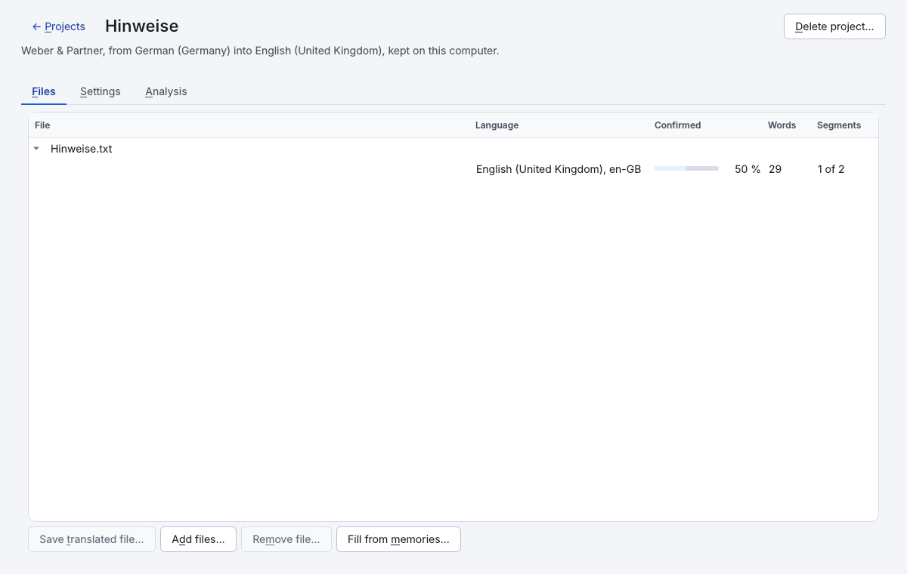
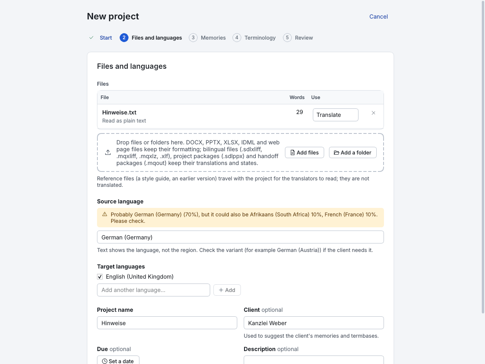
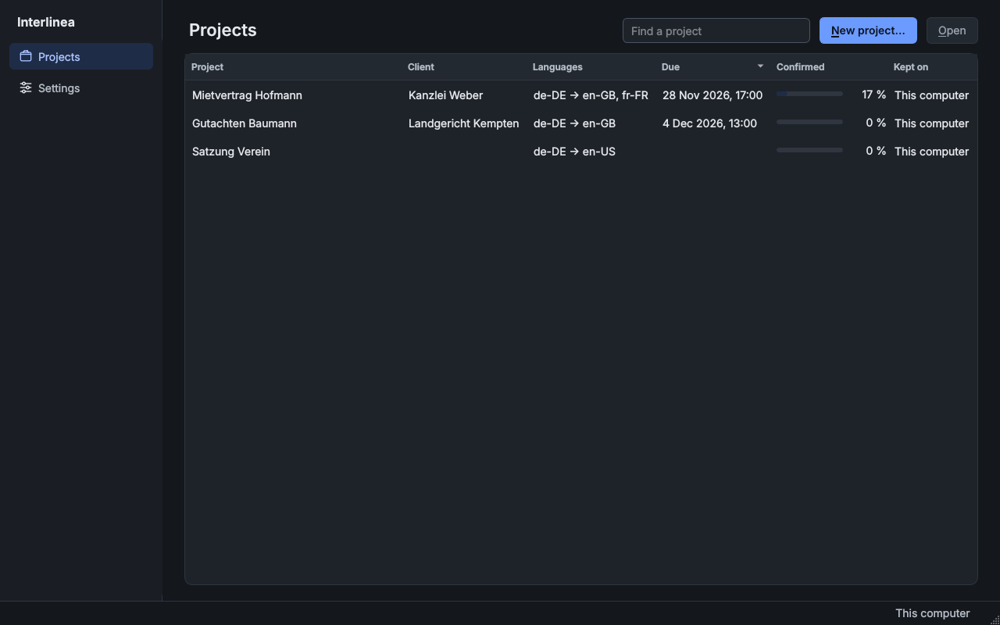

# Desktop app: plan

The desktop app is Interlinea's main client: a native Qt 6 Widgets
application for Windows, macOS and Linux. It works entirely on its own,
without a team server, and connects to one or more team servers when a
team works together. This document is the plan it is built to; each stage
ends with everything in it working, tested and in CI.

## Architecture

```
┌──────────────────────── Interlinea (Qt 6 Widgets, C++20) ───────────────────────┐
│  Projects · Editor · Memories · Terminology · Review · Accounts · Settings      │
│                                                                                  │
│  ApiClient (QNetworkAccessManager, JSON, versions, errors)  ·  Live feed (SSE)   │
│        │                                   │                                     │
│        ▼                                   ▼                                     │
│  Connection "This computer"         Connection "Team server" (0..n)              │
└────────┬─────────────────────────────────────────┬───────────────────────────────┘
         │ http://127.0.0.1:<port>, private token   │ https://..., the person's sign-in
         ▼                                           ▼
  interlinea-core (Go, started by the app)     interlinea-server (Go)
  same API, SQLite in the app's data folder    same API, SQLite or PostgreSQL
```

- **One API for local and team work.** The app ships a Go program,
  `interlinea-core`, and starts it. It runs the same server code as the team
  server, on the loopback interface, with its stores in the app's data
  folder, one account (the person at the computer) and a token only the app
  knows. Everything the app does locally, it does the same way on a team
  server. Nothing needs a network.
- **File work is part of the API.** What the web app does in WebAssembly
  (reading and writing documents, XLIFF and packages, segmentation,
  language detection, QA, spelling, analysis, termbase files) becomes API
  routes, on the core and on the team server alike. Spelling dictionaries
  are installed per core or server.
- **The app holds no second copy of the data.** Lists, segments, entries
  and units come from the API; the live feed keeps open views current.
  Edits are saved as they are made, with versions, so a conflict is caught
  and shown, never overwritten.
- **Sign-ins are kept in the system's keychain** (Windows Credential
  Manager, macOS Keychain, the Secret Service on Linux), never in a plain
  settings file. Provider sign-ins open the system browser and come back to
  the app on a loopback address, which the server already allows.
- **Accessibility** is a requirement, not a polish step: every control has
  an accessible name and role, the segment grid and its tags are exposed to
  screen readers (UI Automation, NSAccessibility, AT-SPI), everything works
  from the keyboard, and the app follows the system's contrast, font size and
  reduced-motion settings.
- **Languages:** English and German, with Qt's translation files.

The core is a separate process: a crash in it can't take the app down, the
app restarts it, and the Go code is built the normal way on all three
platforms.

## Stages

Done: 1 to 7, and the installers of 8. Next: the project page, new
projects and Settings in the web layout, then the rest of 8. The editor,
the project list, Memories, Terminology, the review of merge requests and
Accounts are laid out as the same screens of the browser client, which is
the model for every page; the project page, the new project dialog and
Settings still have their first layout and follow. The browser client's
editor:


1. **Core.** `cmd/interlinea-core`: the server code in local mode (one
   account, loopback only, Host check against DNS rebinding, a handshake on
   standard output, shutdown with the app). File routes: extract and merge
   Word and XLIFF, open and return Trados packages, segment, detect the
   language, read and write termbase files, QA checks and reports, spelling
   with installed dictionaries, analysis and pre-translation of files that
   are not yet in a project. Documented in the API reference; tests.
2. **App foundation.** CMake project, CI on Windows, macOS and Linux with
   Qt 6.8, tests with Qt Test on the offscreen platform. Starting and
   supervising the core, the API client, the live feed, the keychain,
   connections (this computer and team servers: password and provider
   sign-in, setup of a new server), the main window with its navigation,
   Settings, error and offline handling, single instance.
3. **Projects.** Project list across connections, with work and due dates;
   new project from documents (language detection, memories and termbases
   suggested and made, templates); the project page: files, target
   languages, settings, memories and termbases, people and roles, work
   given out, pre-translation, analysis, delivering translated files and
   return packages.
4. **Editor.** The segment grid with tags as objects, confirm and status,
   memory matches with differences, terms in the source, concordance, QA as
   you type and for the file, spelling, filters and search and replace,
   locked segments, presence of others, live updates and conflicts, adding
   terms while translating, preview of the document's structure, keyboard
   shortcuts close to memoQ's and Trados's.
5. **Memories.** The main and project memories on this computer and the
   memories on each team server: new ones (for a client, filled from a TMX
   file), TMX in and out, what uses each, the units of any memory
   searched, added, changed with their tags kept and deleted, who may use
   a server memory, delete.
6. **Terminology.** Termbases (master and project, layered), entries with
   their fields and history, an earlier version restored, deleted entries
   brought back, merge duplicates, import and export (TBX, MultiTerm, CSV,
   TSV, Excel), a project termbase's view of its masters' entries (changed
   for the project, left out, brought back), project termbases made by
   hand, settings (name, languages, fields, masters, review rules, who may
   use it, delete), merge requests and their review (single entries and
   many at once, notes, postponing, undoing a merge, reviewers with their
   parts), what is offered following the role, git or plain wording.
7. **Accounts and roles** on a team server, for administrators and
   managers.
8. **Release.** Installers built by the release workflow from a version
   tag and started once before they are published: a Windows installer
   (Inno Setup, for one person, no administrator rights) and a portable
   folder, a universal macOS disk image (signed for the computer only,
   without a developer certificate), and a Linux AppImage. Still to do:
   accessibility review with NVDA, VoiceOver and Orca; the German
   translation complete; a Flatpak manifest.

## Look

The app uses Qt's Fusion style with a style sheet built from the tokens in
`DESIGN.md`, in a light and a dark variant that follow the system's
setting. `INTERLINEA_THEME=light` or `dark` sets one. Under a high contrast
setting, or with `INTERLINEA_NATIVE_STYLE=1`, the app leaves the
platform's own style alone.

| | |
|---|---|
|  |  |
|  |  |

## Tests

`ctest` runs the app's tests on the offscreen platform against a real core:
the API client, the live feed, the keychain, sign-in with an identity
provider, connections, the window and its accessible names, projects. The
end-to-end test (`tst_endtoend`) also needs a team server and its
administrator:

```
INTERLINEA_TEAM_SERVER=http://127.0.0.1:18080 \
INTERLINEA_TEAM_USER=anna INTERLINEA_TEAM_PASSWORD='a long enough password' \
ctest --test-dir build/desktop -R endtoend
```

It makes a project on this computer and one on the team server, adds
files, fills them from memories, runs the analysis, saves translated files
and return packages, and checks that each step shows in the app. CI runs it
on Linux against a server it starts.

`INTERLINEA_SCREENSHOTS=<folder>` makes `tst_projects` save the
screenshots of the project page and the New project dialog used here.

## Conventions

- C++20, Qt 6.8 LTS (the code also builds with Qt 6.4 for development on
  older Linux), Qt Widgets with the platform's style. No other C++
  dependencies besides the platform keychain APIs.
- Sources in `desktop/`: `src/` (lowercase file names, one class per pair
  of files), `tests/`, `translations/`. Classes in PascalCase.
- No placeholders: a control that is shown works.
