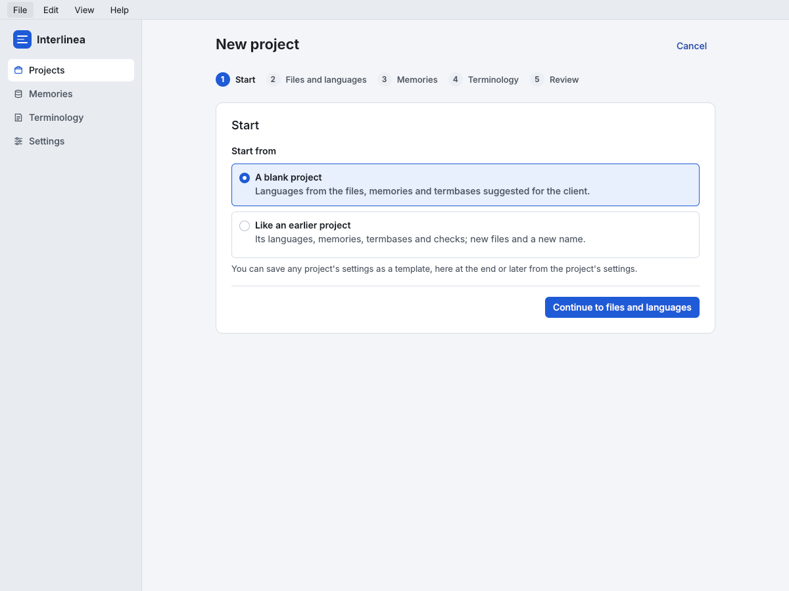
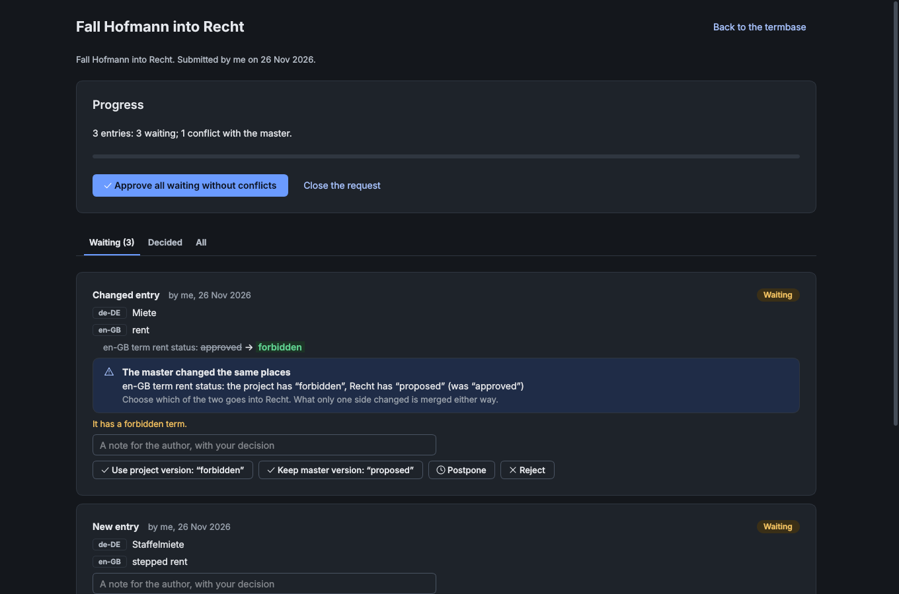

# Desktop app

The desktop app is Interlinea's main client: a native Qt 6 Widgets
application for Windows, macOS and Linux. It works entirely on its own,
without a team server, and connects to one or more team servers when a
team works together. This page describes how it is built; using it is in
[Using Interlinea](guide.md), the same for the desktop app and the browser
client.

## Architecture

```
┌──────────────────────── Interlinea (Qt 6 Widgets, C++20) ───────────────────────┐
│  Projects · Editor · Memories · Terminology · Review · Accounts · Settings      │
│                                                                                  │
│  ApiClient (QNetworkAccessManager, JSON, versions, errors)  ·  Live feed (SSE)   │
│        │                                   │                                     │
│        ▼                                   ▼                                     │
│  Connection "This computer"         Connection "Team server" (0..n)              │
└────────┬─────────────────────────────────────────┬───────────────────────────────┘
         │ http://127.0.0.1:<port>, private token   │ https://..., the person's sign-in
         ▼                                           ▼
  interlinea-core (Go, started by the app)     interlinea-server (Go)
  same API, SQLite in the app's data folder    same API, SQLite or PostgreSQL
```

- **One API for local and team work.** The app ships a Go program,
  `interlinea-core`, and starts it. It runs the same server code as the team
  server, on the loopback interface, with its stores in the app's data
  folder, one account (the person at the computer) and a token only the app
  knows. Everything the app does locally, it does the same way on a team
  server. Nothing needs a network.
- **File work is part of the API.** What the browser client does in
  WebAssembly (reading and writing documents, bilingual files and packages,
  segmentation, language detection, checks, spelling, analysis, termbase
  files, alignment) the app asks the core for, through the same routes a
  team server has. The spelling dictionaries that come with Interlinea are
  installed next to the core.
- **The app holds no second copy of the data.** Lists, segments, entries
  and units come from the API; the live feed keeps open views current.
  Edits are saved as they are made, with versions, so a conflict is caught
  and shown, never overwritten.
- **Sign-ins are kept in the system's keychain** (Windows Credential
  Manager, macOS Keychain, the Secret Service on Linux); where none can be
  used, Settings says where they are kept instead and why. Provider sign-ins open the system browser and come back to
  the app on a loopback address, which the server already allows.
- **Accessibility** is a requirement, not a polish step: every control has
  an accessible name and role, the segment grid and its tags are exposed to
  screen readers (UI Automation, NSAccessibility, AT-SPI), everything works
  from the keyboard, and the app follows the system's contrast, font size and
  reduced-motion settings.
- **Languages:** the interface is in English, German or Korean, from the
  catalogs in `i18n/` that the browser client uses too
  (`go run ./i18n/gen -check` finds a string without a translation).

The core is a separate process: a crash in it can't take the app down, the
app restarts it, and the Go code is built the normal way on all three
platforms.

## Pages

Every page is laid out as the same screen of the browser client, which is
the model: the project list, New project in its steps, the project page,
the editor, Memories with alignment, Terminology with the review of merge
requests, Accounts on a team server, and Settings.

- **Projects:** the projects on this computer and on each team server,
  with their work and due dates; new projects from documents, folders,
  bilingual files and packages, with the source language detected and the
  client's memories and termbases suggested; the project page with its
  files, languages, settings, memories and termbases, people, work given
  out, pre-translation, analysis, and the translated files or return
  packages.
- **Editor:** the segments with tags as objects, matches with their
  differences, terms in the source, concordance, checks as you type,
  spelling, filters, search and replace, locked segments, who else works
  on the file, live changes and conflicts, terms added while translating,
  the preview, and keyboard shortcuts close to those of the common tools.
- **Memories:** the main and project memories on this computer and on
  each team server; memories made from TMX, Trados Studio and Wordfast
  files, exported as TMX, searched, and their units changed; documents
  aligned with their translations into a memory, with sections moved into
  the document's order where the translation has them elsewhere.
- **Terminology:** master and project termbases, entries with their fields
  and history, earlier versions brought back, duplicates merged, import and
  export (TBX, MultiTerm, CSV, TSV, Excel), merge requests and their
  review, printed glossaries, in plain words or the words of git.
- **Accounts** on a team server, for administrators and managers.

## Releases

The release workflow builds the app from a version tag and starts each
build once before it is published: a Windows installer (Inno Setup, for
one person, without administrator rights) and a portable zip, a universal
macOS disk image, and a Linux AppImage. The Windows files are not signed
with a code signing certificate and the macOS app is signed for the
computer only and not notarized, so both systems warn on the first start;
[signing.md](signing.md) says what the workflow does once the
certificates are there.

Not done yet: a review with NVDA, VoiceOver and Orca by people who use
them every day, and a Flatpak.

## Look

The app uses Qt's Fusion style with a style sheet built from the tokens in
`DESIGN.md`, in a light and a dark variant that follow the system's
setting. `INTERLINEA_THEME=light` or `dark` sets one. Under a high contrast
setting, or with `INTERLINEA_NATIVE_STYLE=1`, the app leaves the
platform's own style alone.

| | |
|---|---|
|  |  |

## Tests

`ctest` runs the app's tests on the offscreen platform against a real core:
the API client, the live feed, the keychain, sign-in with an identity
provider, connections, the window and its accessible names, projects. The
end-to-end test (`tst_endtoend`) also needs a team server and its
administrator:

```
INTERLINEA_TEAM_SERVER=http://127.0.0.1:18080 \
INTERLINEA_TEAM_USER=anna INTERLINEA_TEAM_PASSWORD='a long enough password' \
ctest --test-dir build/desktop -R endtoend
```

It makes a project on this computer and one on the team server, adds
files, fills them from memories, runs the analysis, saves translated files
and return packages, and checks that each step shows in the app. CI runs it
on Linux against a server it starts.

`INTERLINEA_SCREENSHOTS=<folder>` makes the tests save every page they
reach, which is where the desktop screenshots here come from;
`INTERLINEA_THEME=dark` takes them in the dark variant.

## Conventions

- C++20, Qt 6.8 LTS (the code also builds with Qt 6.4 for development on
  older Linux), Qt Widgets with the platform's style. No other C++
  dependencies besides the platform keychain APIs.
- Sources in `desktop/`: `src/` (lowercase file names, one class per pair
  of files), `tests/`, `packaging/`. Classes in PascalCase.
- No placeholders: a control that is shown works.
