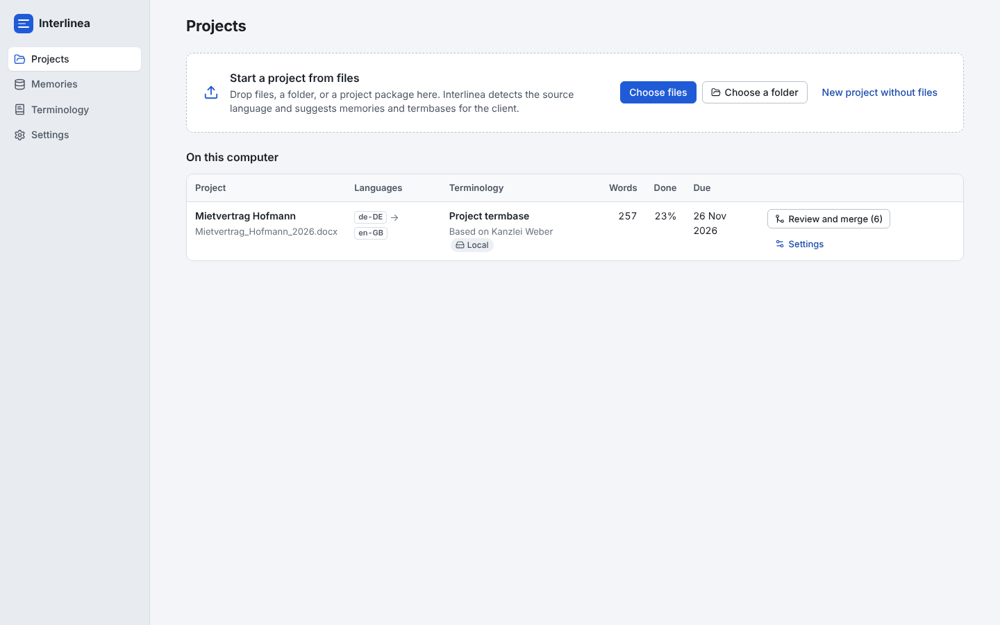
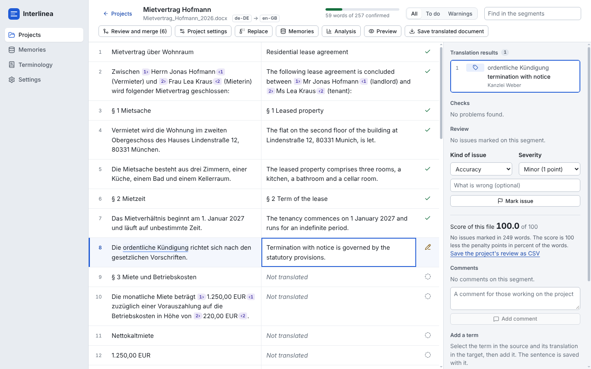
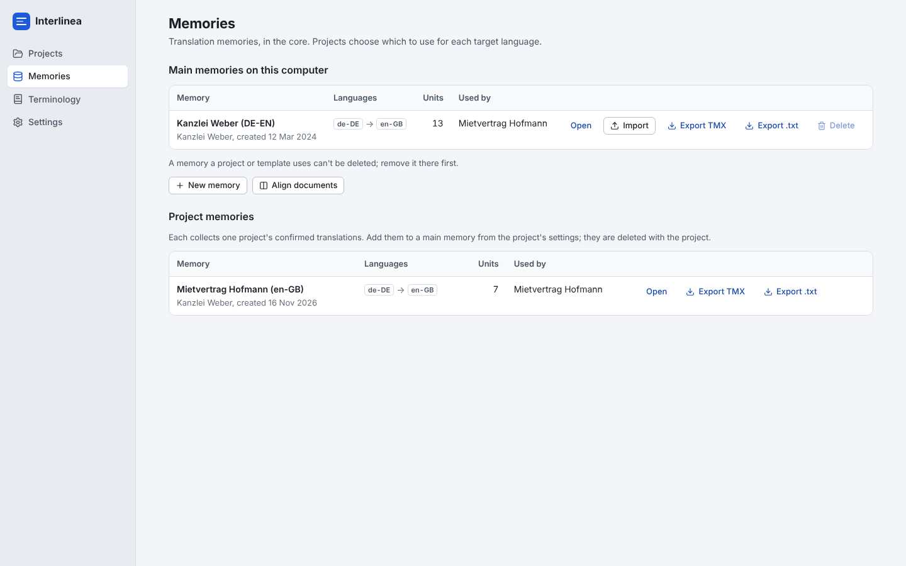
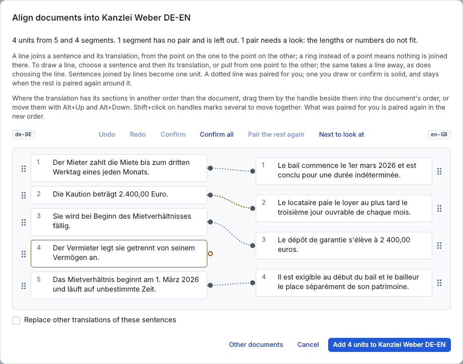
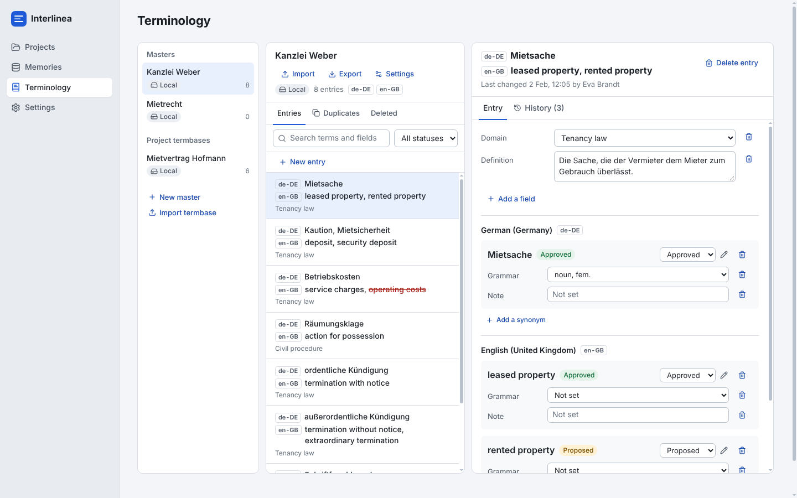
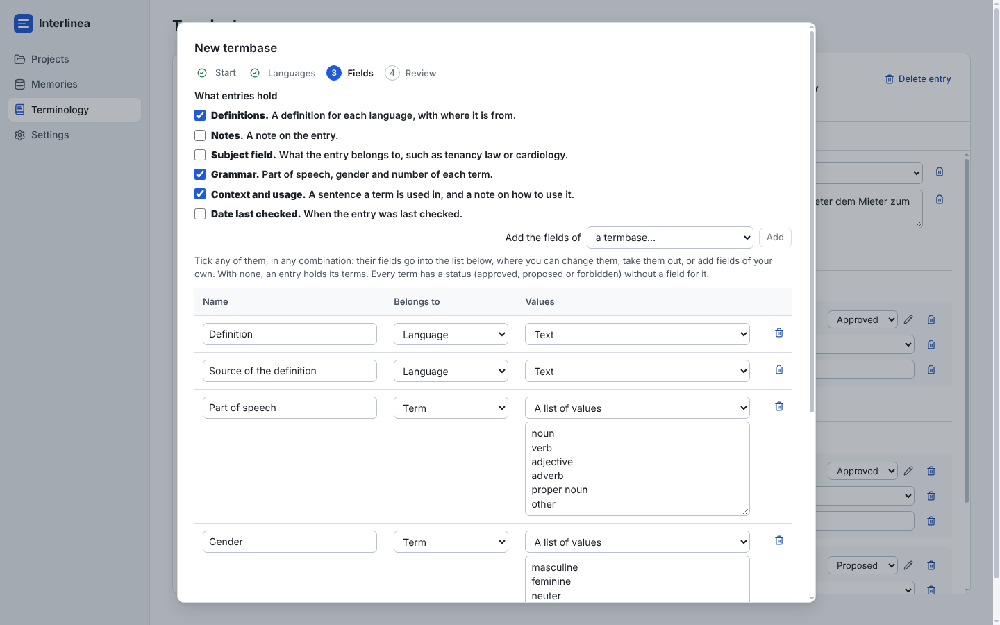
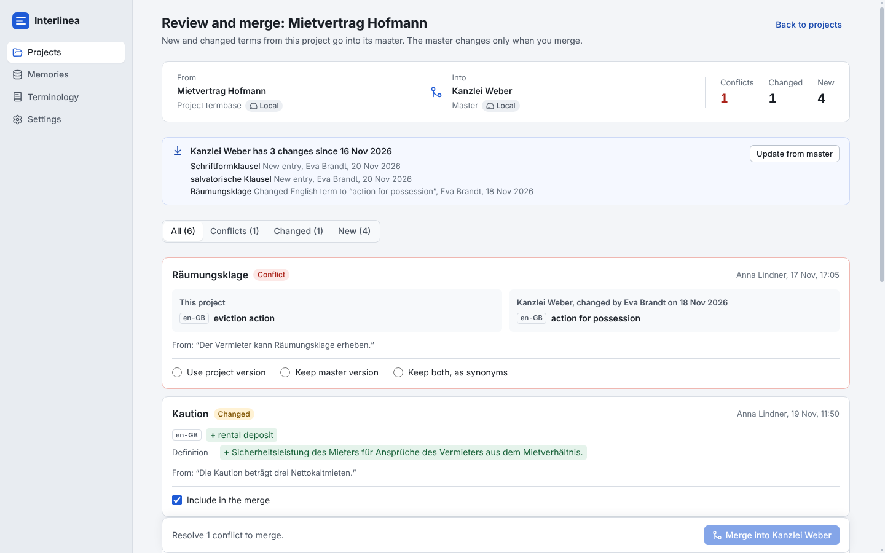
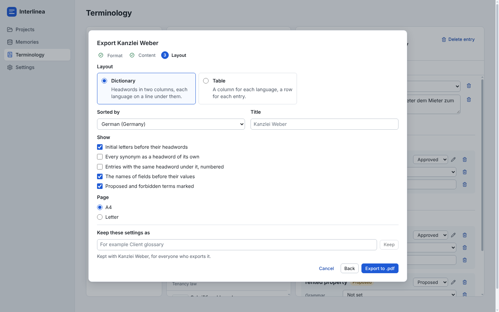
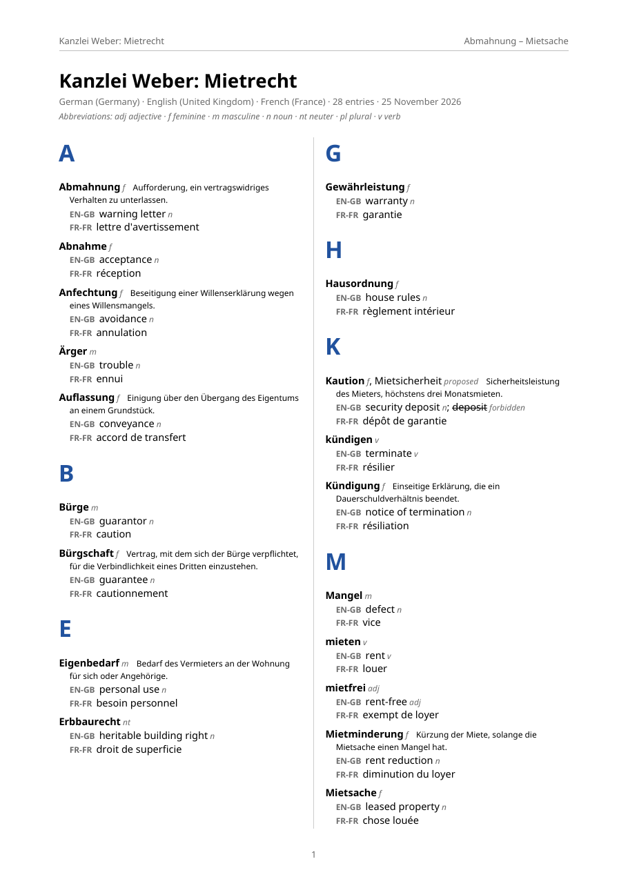

# Using Interlinea

The desktop app and the browser client have the same pages, laid out the
same way: Projects, the editor, Memories, Terminology and Settings, and
Accounts on a team server. The screenshots here are of the browser
client; the desktop app looks the same.

The desktop app works on its own, with your work in its data folder. The
browser client works on its own too, with your work kept in the browser.
Both sign in to team servers, where projects, memories and termbases are
shared.

The interface is in English, German or Korean: Settings, Interface
language. By default it follows the language of the browser or the
system; the browser client switches at once, the desktop app when it is
started again. Documents, projects and termbases keep their own languages.

## Trying it out

The browser client starts empty. Your work is saved in the browser (IndexedDB) as you go:
projects with their files, translations, termbases, memories, templates and
settings are there again on the next visit. Settings shows whether saving
works in this browser and can delete everything kept there; `?reset` in the
address does the same on load.

To look around before bringing your own files, add `?sample` to the
address: it adds a sample project (a tenancy agreement of an invented law
firm, a real Word file in `web/samples`) with its master termbase, a
project termbase that has changes to review and merge, and a translation
memory. What you already have stays.

## Projects

New project starts blank, from a template, or like an earlier project, then
takes the files and languages, the memories, the terminology and a review,
each checked by the core's project validation:

- several files and whole folders, kept with their paths; each file is
  translated or a reference file (what Interlinea can't read becomes one);
  a Trados package (.sdlppx) becomes one project with all its files;
- one source and several target languages; a bilingual file is translated
  only into the language it was made for;
- name, client, due date and description;
- memories per target language, in priority order, each used for lookup,
  concordance and updating as chosen, with a penalty in points; new memories,
  empty or from a memory file (TMX, Trados Studio, Wordfast); a project
  memory per language that collects confirmed
  translations;
- master termbases suggested for the client; a master lacking a project
  language gains it only when you choose so; where new terms go; where the
  project termbase is kept; whether master changes come in on opening;
- the core's quality checks to run, a spelling dictionary per target language,
  words always spelled right, rules of the project's own (regular
  expressions), the context match rule, pre-translation
  (lowest match, which matches are confirmed), the core's analysis per target
  language, and saving the settings as a template.

Every choice can be changed later on the project's settings page, which also
adds and removes files and target languages, adds a project memory's units to
a main memory, pre-translates again, saves a template and deletes the
project.

Spelling dictionaries for 22 languages and regions come with Interlinea:
English (US, UK), German (Germany, Austria, Switzerland), French, Spanish
(Spain, Mexico), Italian, Portuguese (Portugal, Brazil), Dutch, Polish,
Russian, Swedish, Danish, Norwegian Bokmål, Czech, Korean, Ukrainian,
Hungarian and Romanian. A new project takes the one that fits each target
language by itself. Settings lists them and adds others: Hunspell
dictionaries as LibreOffice extensions (.oxt), ZIP files, or .aff and .dic
files. One added under the name of an included dictionary is used in its
place, and deleting it brings the included one back. In the editor a spelling
warning offers the dictionary's suggestions and adding the word to the
project's words, and a segment with a length limit from its file (XLIFF
maxwidth) counts its characters. A subtitle shows its longest line, its
lines and its reading speed against the project's limits as it is typed
([how they are counted](matching.md#subtitles)).

## The editor

Creating a project opens it in the editor. It follows the conventions
translators know from the common desktop tools:

- each segment shows the match it was translated from (CM for a context
  match, a percentage coloured by its band, or a repetition), outlined once
  edited and with penalties taken off; an empty segment shows none;
- the best match goes into an empty segment when it opens;
- Ctrl+Enter confirms the segment and fills its repetitions, Ctrl+1 to 9
  insert the numbered results, Ctrl+K searches the memory, and F9 inserts
  the next tag;
- terms from the termbases are recognized in the source, inflected forms
  included, and added while translating with the sentence they came from;
- the project's checks run as you type and again on confirm (consistency
  across the file included), and stay on the segment as warnings until
  fixed or ignored;
- confirmed segments go into the memories the project updates;
- a segment is split at any place and joined with the next one, in its
  paragraph or across paragraphs, since languages divide a text into
  paragraphs differently: the translation stands in the first, and the
  later paragraphs lose what was joined ([formats.md](formats.md) says
  what each format writes). Split again where they met, the segments
  stand apart again.

A project with several files or target languages switches between them in
the editor's header. Analysis counts the matches of all files of a
language, and is also shown before a project is made. Preview shows the
translated document with its headings, tables and footnotes, and a click
in it opens the segment.

Bilingual files from Trados (.sdlxliff), memoQ (.mqxliff) and other tools
(.xlf, .xliff) open as projects with their translations and states: the
languages come from the file, translated segments arrive confirmed,
locked segments are read-only, reviewer approvals and rejections are
shown, and "Save XLIFF" writes the file back under its own name with only
the changed segments and states. A Trados project package (.sdlppx) becomes
a project with all its files, and "Save return package" writes one .sdlrpx
with every file translated. [formats.md](formats.md) has every format.

Word documents (.docx) you choose go through the core's Word filter, running
in the browser as WebAssembly: the units keep their formatting as tags, and
"Save translated document" writes the .docx with the original layout.

## Memories

Memories lists all memories with their units and users, creates,
imports into, exports and deletes them, and opens each to search, add, change
and delete its units.

Align documents makes memory units from a document and its translation:
the sentences are paired by their lengths, with numbers as anchors, and
you check the pairs, draw the ones that are wrong and confirm them before
they go into the memory. Where the translation has its sections in another
order than the document, drag them by the handle beside them into the
document's order (Alt+Up and Alt+Down do the same, and Shift+click on the
handles marks several to move together): the sentences are paired again
in the new order, around the pairs already confirmed.

## Terminology

Terminology manages termbases: create, rename and delete them, set their
languages and fields, add and edit entries, terms and statuses, find and
merge duplicates, import TBX, MultiTerm XML, Excel and CSV files (with column
and language mapping and a preview of what the import changes), and export
in all of these formats.

### Making a termbase

A termbase is made in a few steps, in the browser client and in the
desktop app alike:

1. **Name and kind.** A *master* is a termbase of its own, kept across
   projects for a client, a subject or a company. A *project termbase*
   is based on one or more masters, as a branch is on what it branches
   from: it shows their entries, has their languages and fields, and
   submits its new and changed entries to them for review.
2. **Languages** (masters only), chosen from the list of languages with
   a search by name or code. A termbase has languages, not a source and
   a target.
3. **Fields.** Groups of fields are ticked in any combination:
   definitions with their source, notes, subject field, grammar (part
   of speech, gender, number), context and usage, and the date last
   checked. Each puts its fields in the list, and takes them out again
   when it is unticked; the fields of another master can be added too,
   and fields of one's own. With none, an entry holds its terms. A field
   belongs to the entry, to each language or to each term, and takes
   text, a value from a list, a number, a date, or yes or no. A project
   termbase can add fields of its own; such a field reaches a master
   with the first entry that uses it, once a reviewer approves the entry.
4. **Review** of what will be made, before it is made.

Fields are added, renamed, given another kind or taken out later in the
termbase's settings, and added from any entry. Each kind of field has its
own control in an entry: a list to choose from, yes or no, a date, a
number that is checked, or text.

### Review and merge

A project termbase collects the terms its project adds and changes. They
reach the master only through a review: each new or changed entry is
shown against the master, conflicts (the master changed the same place)
are decided one by one, and nothing changes in the master until the
merge. On a team server, review rules say who reviews what, and a merge
request can be split among several reviewers.

## Glossaries

A termbase is exported as a glossary to read, print or send: a PDF, a
Word document, a web page with a letter index and a search, or plain
text. The dictionary layout sets headwords in two columns with each
language on a line under them, initial letters, and the first and last
headword of each page in its running head; the table layout gives each
language a column. Grammar fields (part of speech, gender, number) are
abbreviated as dictionaries do, with a list of the abbreviations used.

What goes in is chosen in the same dialog, for glossaries and exchange
formats alike: languages and the one to sort by, entries (all, those a
search shows, those with a field value, those changed since a day), term
statuses and fields. Settings are kept with the termbase by name.

PDF files are made without any other program. The fonts for Latin,
Greek, Cyrillic, Arabic and Hebrew come with the app (Noto, under the SIL
Open Font License); other scripts take the fonts installed where the PDF
is made.

## Working on a team server

Settings signs in to a team server (the one serving
the web app is offered; passwords, or the server's identity provider).
Projects then lists the projects on the server you may see, with the work
given to you. New project asks, at the review, whether the project is kept
on this computer or on the server; on the server, memories and master
termbases it doesn't have yet are uploaded with the project, which gets its
own memory per language and its project termbase there. A server project's
page shows its details, files, the work given out (managers give out files,
languages or segment ranges to translators and reviewers, with due dates;
everyone reports their own work done) and who is working now.

The editor opens a server project from the server: the original files are
read here with the same filters, for the preview and the limits and notes of
bilingual files, and the server's segments give the translations. Segments
not given to you are read-only and say whose they are. Translations are
saved on the server as you type and confirm; when someone else saved first,
their version is shown and you are told. Others' translations, new terms and
memory units arrive live, and markers show who has which segment open.
Nothing of a server project is saved in the browser; the sign-in is.

## Settings

Settings has:

- the interface language;
- the appearance: light, dark, or as the system is set (the default); it
  changes at once, in the desktop app and in the browser client, which
  keeps the choice in the browser;
- the wording of the terminology pages: plain words, or the terms of git
  (branch, merge request);
- the editor's options;
- the team servers you sign in to;
- translation and grammar services, and access tokens for other programs
  and assistants ([integration.md](integration.md));
- spelling dictionaries, project templates and your name;
- in the browser client, what is saved in the browser and deleting it;
- About Interlinea: the version, the licence and the copyright notice.
